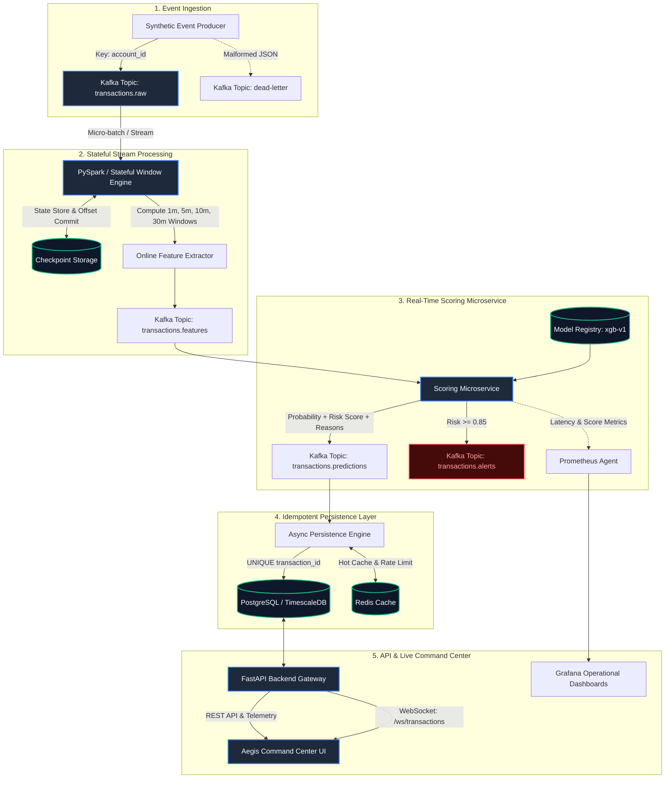

# Aegis System Architecture

## 1. High-Level Overview

**AEGIS** is a distributed, event-driven, real-time fraud detection engine designed to ingest thousands of high-velocity financial transactions per second, perform stateful sliding-window feature engineering, score transactions against a trained XGBoost classifier with sub-millisecond latency, and provide real-time alert triage via a reactive command center.

The platform is named after **Aegis** (Greek: *αἰγίς*), the legendary mythical shield of Athena and Zeus, symbolizing impenetrable, proactive defense against malicious actors.

---

## 2. End-to-End System Architecture

---

## 3. Core Component Breakdown

### 3.1. Event Ingestion (Kafka KRaft)
- **Topic Configuration**: `transactions.raw` with 6 partitions.
- **Partition Key**: Partitioned strictly by `account_id`.
  - *Design Rationale*: Account-level partitioning guarantees that all events belonging to a specific account arrive at the exact same partition in strictly monotonic chronological sequence. This avoids out-of-order state mutations when computing transaction velocity and geographic displacement.
- **Dead-Letter Queue (`dead-letter`)**: Captures schema-violating or corrupted JSON payloads without halting the streaming pipeline.

### 3.2. Stateful Streaming & Feature Engine (PySpark / Sliding Windows)
- **Window Semantics**: Evaluates tumbling and sliding windows (1-minute, 5-minute, 10-minute, 30-minute) aggregated per `account_id`.
- **Watermarking**: 10-minute event-time watermark allows late-arriving events within the grace period while bounding state store growth.
- **Checkpointing**: Every micro-batch commits offsets and state checkpoints to `/checkpoints/aegis/features`, ensuring exactly-once fault recovery.

### 3.3. Scoring Microservice
- **Model Execution**: In-memory loaded XGBoost binary classifier trained with `scale_pos_weight` to address extreme class imbalance (1.2% fraud).
- **Latency Profile**: Sub-millisecond inference (~0.53ms P50, ~0.60ms P95).
- **Reason-Code Engine**: Generates human-auditable explanations (`HIGH_TRANSACTION_VELOCITY`, `UNUSUAL_AMOUNT`, `IMPOSSIBLE_TRAVEL`, etc.) alongside raw probability scores.

### 3.4. Idempotent Persistence (PostgreSQL & Async Engine)
- **Constraint Enforcement**: `UNIQUE(transaction_id)` enforces strict idempotency. If a duplicate event arrives (e.g., following a network timeout or consumer restart), the existing record is returned without duplicating alert workflows or metrics.
- **Indexed Schema**: B-Tree indexes on `(account_id, timestamp)`, `(decision)`, and `(created_at)`.

### 3.5. Real-Time Command Center (FastAPI & React)
- **Communication Protocol**: Full-duplex WebSocket (`/ws/transactions`) streams live enriched transactions and SOC alerts directly into the UI.
- **Design System**: Dark cybersecurity-themed glassmorphism interface featuring KPI cards, transaction dossiers, velocity charts, and alert triage.

---

## 4. Key Architectural Decisions

| Decision | Alternative Considered | Why Aegis Chose This Approach |
| :--- | :--- | :--- |
| **Kafka with KRaft Mode** | ZooKeeper-based Kafka | Eliminates ZooKeeper operational overhead; metadata quorum is managed natively by Kafka brokers with faster failovers. |
| **Account-Based Partitioning** | Random Round-Robin | Round-robin destroys event ordering across consumer threads. Hashing on `account_id` ensures per-account serial consistency. |
| **PySpark Structured Streaming** | Flink, Apache Storm | PySpark integrates natively with enterprise data lakes, Python ML artifacts, and provides unified batch/stream APIs. |
| **XGBoost Classifier** | Random Forest, Deep Learning (MLP) | XGBoost offers superior handling of tabular imbalanced data, native fast C++ runtime, and microsecond inference latencies. |
| **FastAPI Async Engine** | Flask, Django REST | Native async/await event loop, Pydantic type validation, automatic OpenAPI documentation, and built-in WebSocket support. |
| **PostgreSQL Unique Constraints** | Application-level deduplication | DB-level constraints provide an unbreakable atomic guarantee against race conditions in distributed multi-worker environments. |
