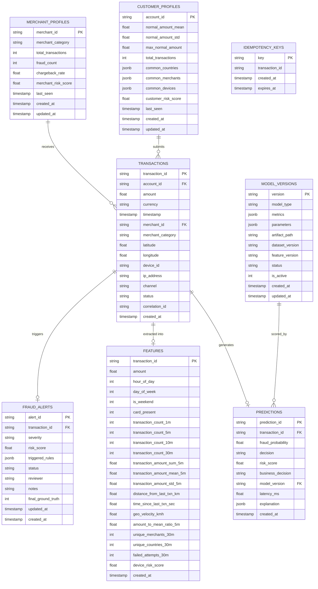

# Database Schema & Entity-Relationship Architecture

This document documents the relational database architecture, indexes, and entity relationships backing Aegis.

## Indexing Strategy
To guarantee sub-millisecond lookups during high-velocity streaming:
1. `idx_transactions_account_timestamp`: Composite B-Tree index on `(account_id, timestamp DESC)` for fast historical sliding window retrieval.
2. `idx_predictions_decision`: Single-column index on `predictions(decision)` and `predictions(business_decision)` for triage filtering.
3. `idx_alerts_status`: B-Tree on `fraud_alerts(status)` for SOC analyst queue queries (`NEW`, `UNDER_REVIEW`).
4. `idx_idempotency_key`: Unique primary index on `idempotency_keys(key)` ensuring hardware-level constraint enforcement.

