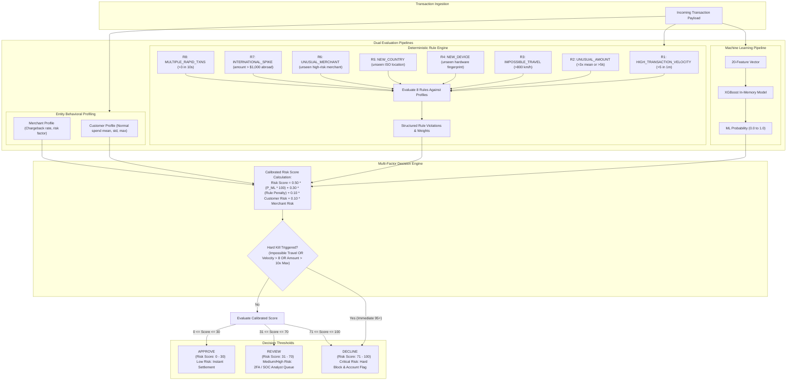

# Fraud Risk Decision Engine Architecture

This document details the multi-factor risk scoring pipeline combining machine learning inferences, deterministic business rules, behavioral profiles, and threshold-based decision policies.

## Risk Score Calibration Formulas
The composite risk score $S \in [0, 100]$ is computed as:
$$S = \text{clamp}\left(0.50 \cdot (p_{\text{fraud}} \times 100) + 0.30 \cdot W_{\text{rules}} + 0.10 \cdot S_{\text{customer}} + 0.10 \cdot S_{\text{merchant}} + \Delta_{\text{spend}}, 0, 100\right)$$

Where:
- $p_{\text{fraud}}$: Raw probability predicted by XGBoost model.
- $W_{\text{rules}}$: Sum of severity-weighted rule violations (Critical: 35, High: 20, Medium: 10, Low: 5), capped at 100.
- $S_{\text{customer}}$: Customer risk score based on historical chargeback or dispute history.
- $S_{\text{merchant}}$: Merchant risk score derived from historical fraud-to-transaction ratio.
- $\Delta_{\text{spend}}$: Extra penalty if current transaction exceeds 3 standard deviations from normal spend.

