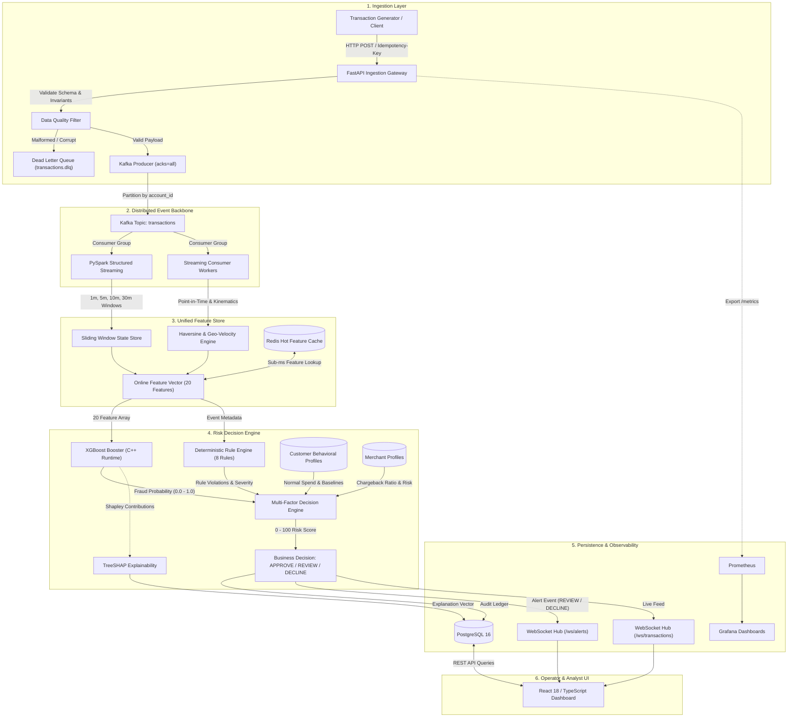

# High-Level System Architecture

This document describes the end-to-end architecture of **Aegis — Distributed Event-Streaming & Real-Time Fraud Engine**.

## Data Lifecycle Summary
1. **Generation & Verification**: Transactions are validated against banking invariants (bounds, coordinates, currencies). Invalid transactions route to the Dead-Letter Queue (DLQ).
2. **Log Partitioning**: Valid transactions are written to Kafka partitioned by `account_id`, guaranteeing chronological ordering per customer.
3. **Stateful Feature Extraction**: Streaming consumers calculate sliding temporal aggregations (1m, 5m, 10m, 30m) and kinematic distance metrics (Haversine speed in km/h).
4. **Scoring & Explainability**: The XGBoost booster computes the statistical probability of fraud ($p_{\text{fraud}}$), while the Rule Engine evaluates 8 deterministic security rules.
5. **Multi-Factor Decisioning**: The Risk Decision Engine blends ML probability, rule penalties, customer behavioral profiles, and merchant risk into a calibrated 0–100 risk score and business action (`APPROVE`, `REVIEW`, `DECLINE`).
6. **Audit & Triage**: Predictions, features, and TreeSHAP attributions are persisted to PostgreSQL and broadcast via WebSockets to the SOC triage dashboard.

