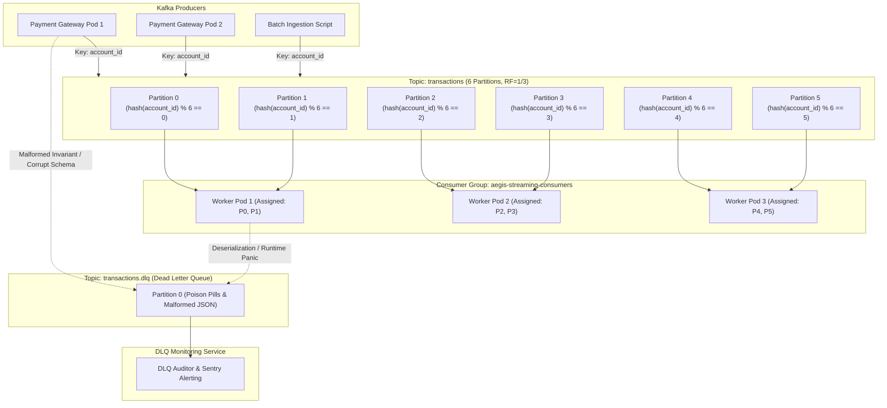

# Kafka Event Streaming Architecture

This document details the Kafka topic topology, partition hashing strategy, consumer groups, and fault-tolerant dead-letter queues.

## Partition Hashing Guarantee
- **Partition Key**: Every event published to `transactions` specifies `account_id` as the message key.
- **Strict Ordering**: Because Kafka routes identical keys to the same partition, all transactions for `acc_12345` are sequentially processed in order of publication.
- **Race Condition Prevention**: Prevents concurrent workers from simultaneously evaluating consecutive transactions for the same user, which would otherwise distort time-delta and velocity calculations.

## Consumer Rebalance Protocol
- When an Aegis consumer worker crashes, Kafka's group coordinator triggers a cooperative rebalance (`CooperativeStickyAssignor`).
- Active partitions are redistributed among surviving pods without halting consumption on unrelated partitions.
- Offset commits occur only after successful database persistence and feature caching, ensuring at-least-once durability backed by idempotent writes.

