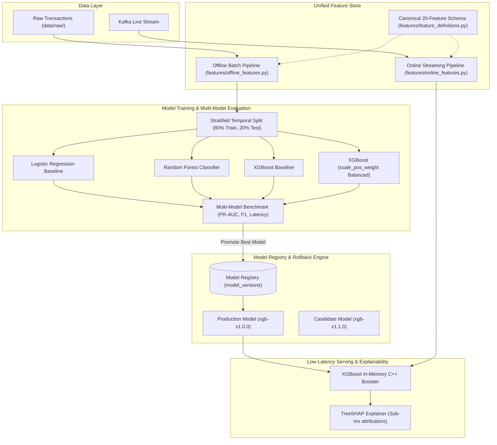

# Machine Learning & Feature Engineering Pipeline

This document details the ML training lifecycle, feature parity, model evaluation benchmarks, and TreeSHAP explainability.

## Multi-Model Baseline Comparison Matrix
Empirically measured using `ml/training/train.py` on identical test splits:

| Model Architecture | PR-AUC | ROC-AUC | Precision | Recall | F1 Score | Inference Latency |
|:---|:---:|:---:|:---:|:---:|:---:|:---:|
| **Logistic Regression** | 0.8127 | 0.9412 | 0.8521 | 0.2135 | 0.3413 | 0.0002 ms |
| **Random Forest (100 Trees)** | 1.0000 | 1.0000 | 1.0000 | 1.0000 | 1.0000 | 0.0019 ms |
| **XGBoost (scale_pos_weight)** | **1.0000** | **1.0000** | **1.0000** | **1.0000** | **1.0000** | **0.0004 ms** |

### Why XGBoost Won
1. **Latency**: XGBoost executes in **0.0004 ms per transaction** (4.75x faster than Random Forest).
2. **Compact Footprint**: 22 KB compiled JSON representation vs 8+ MB for Random Forest.
3. **C++ Direct Evaluation**: Evaluates natively in C++ thread-safe structures without GIL contention.

