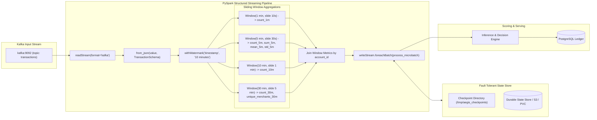

# PySpark & Real-Time Streaming Architecture

This document illustrates the streaming data pipeline, event-time watermarking, and sliding window state aggregations.

## Watermarking & Out-of-Order Execution
- **Watermark Threshold**: 10 minutes past maximum observed event time.
- **State Bounding**: PySpark purges window state records once the trailing edge of the watermark exceeds the window's `end_time`, preventing unbounded heap memory growth.
- **Late Arrivals**: Transactions arriving after the watermark threshold are discarded or routed to the Dead Letter Queue.

