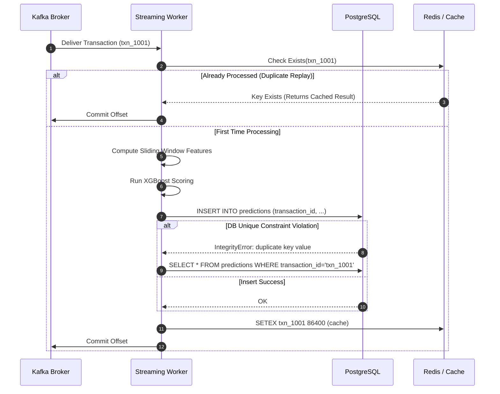

# Aegis Fault Tolerance, Idempotency & Disaster Recovery

## 1. The Distributed Failure Challenge

In any real-time event-streaming architecture handling financial transactions, failures are inevitable:
- Kafka consumer pods may restart during network rebalancing.
- Database write locks may cause transient timeouts.
- Network partitions can lead to message redelivery.
- Upstream payment processors may replay historical transactions.

Without robust fault tolerance and **idempotent processing**, message replays create duplicate fraud alerts, erroneous analytics, and operational chaos for SOC analysts.

---

## 2. Idempotent Event Processing

Aegis enforces end-to-end idempotency at both the application and database tiers.



### 2.1. PostgreSQL Unique Constraint Enforcement
Every prediction and transaction record is anchored by a strict relational constraint:

```sql
CREATE TABLE predictions (
    id SERIAL PRIMARY KEY,
    transaction_id VARCHAR(64) NOT NULL UNIQUE,
    fraud_probability FLOAT NOT NULL,
    risk_score FLOAT NOT NULL,
    decision VARCHAR(20) NOT NULL,
    model_version VARCHAR(32) NOT NULL,
    created_at TIMESTAMP WITH TIME ZONE DEFAULT CURRENT_TIMESTAMP
);
```

If a consumer restarts before committing its Kafka offset, Kafka redelivers the uncommitted batch. When Aegis attempts to insert the duplicate `transaction_id`, the database raises an `IntegrityError`. 

The transaction handler intercepts this exception and retrieves the original prediction without raising an alert or corrupting metric counters:

```python
# services/api/routes/transactions.py
try:
    async with async_session_factory() as session:
        session.add(prediction_record)
        await session.commit()
except IntegrityError:
    # Atomic idempotency: Return existing prediction
    await session.rollback()
    existing = await session.execute(
        select(PredictionModel).where(PredictionModel.transaction_id == txn_id)
    )
    return existing.scalar_one()
```

---

## 3. Dead-Letter Queue (DLQ) Architecture

When a consumer encounters unparseable JSON, illegal character encodings, or schema validation failures, **it must never crash the streaming pipeline**.

Instead, Aegis routes malformed events to the `dead-letter` Kafka topic:

```python
try:
    event = TransactionEvent.model_validate_json(raw_payload)
except ValidationError as e:
    dlq_payload = {
        "raw_payload": raw_payload.decode("utf-8", errors="replace"),
        "error_type": "ValidationError",
        "error_details": e.errors(),
        "failed_at": datetime.now(timezone.utc).isoformat()
    }
    kafka_producer.send("dead-letter", key=b"dlq_error", value=json.dumps(dlq_payload).encode())
    metrics.dead_letter_events_total.inc()
```

This insulates the real-time scoring engine while preserving the raw corrupted payload for offline inspection and replay.

---

## 4. Disaster Recovery & Node Failover Scenarios

| Failure Scenario | Immediate System Reaction | Recovery Mechanism |
| :--- | :--- | :--- |
| **Kafka Broker Failure** | In-flight producers retry with exponential backoff (`retries=5`). KRaft leader election elects new partition leader. | Zero data loss. Once new leader is elected, consumers reconnect and resume stream ingestion. |
| **Spark Streaming Crash** | Spark pod terminates. Checkpoint directory holds uncommitted offsets and RocksDB state store. | Replacement pod initializes, reads `/checkpoints/aegis/features/`, restores state store, and resumes exactly from last committed offset. |
| **Scoring Microservice OOM** | Kubernetes HPA detects pod termination and spins up healthy replica. | Traffic automatically routes to surviving scoring replicas via Kubernetes ClusterIP service. |
| **PostgreSQL Network Partition** | SQLAlchemy async connection pool catches disconnects; retries with exponential backoff (100ms $\to$ 2s). | Upon reconnection, transactions are persisted idempotently. |
