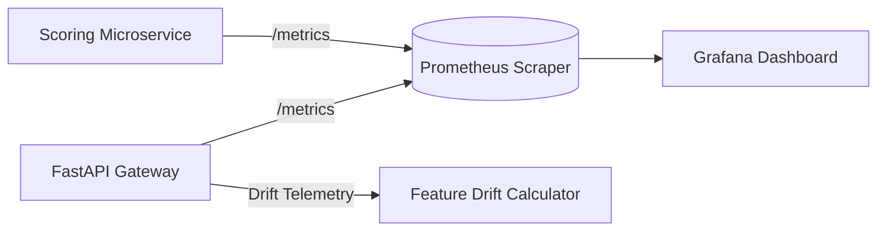

# Aegis Monitoring, Telemetry & Model Drift Detection

## 1. Observability Architecture

Aegis implements production-grade observability across three tiers:
1. **Prometheus Metrics**: Exposes real-time throughput, counter, and latency distributions via standard `/metrics` endpoints.
2. **Grafana Dashboards**: Unified visual panels for real-time operations, throughput rates, and risk scoring distributions.
3. **Structured JSON Logging**: Standardized contextual JSON logs containing service names, correlation IDs, transaction IDs, latency values, and decisions.

---

## 2. Core Prometheus Metric Catalog

| Metric Name | Type | Description | Labels |
| :--- | :--- | :--- | :--- |
| `aegis_events_received_total` | Counter | Total raw transaction events received from stream | `source` |
| `aegis_events_processed_total` | Counter | Total events successfully parsed and scored | `status` |
| `aegis_fraud_predictions_total` | Counter | Total inferences generated by model | `decision` (`LEGITIMATE`, `SUSPICIOUS`, `FRAUD`) |
| `aegis_fraud_alerts_total` | Counter | Total high-priority fraud alerts triggered | `severity` (`LOW`, `MEDIUM`, `HIGH`, `CRITICAL`) |
| `aegis_prediction_latency_ms` | Histogram | Latency distribution of model scoring in milliseconds | `le` (0.5, 1.0, 2.0, 5.0, 10.0, 25.0, 50.0, 100.0) |
| `aegis_http_requests_total` | Counter | HTTP request count to backend API | `method`, `endpoint`, `status` |
| `aegis_http_request_duration_seconds`| Histogram | HTTP request duration in seconds | `method`, `endpoint` |
| `aegis_duplicate_events_total` | Counter | Total duplicate transaction events intercepted | `account_id` |

---

## 3. Grafana Operational Dashboards

Aegis includes pre-configured Grafana dashboards in `monitoring/grafana/dashboards/aegis_dashboard.json`:

1. **Ingestion & Throughput Panel**:
   - `rate(aegis_events_received_total[1m])`
   - Real-time gauge of transactions per second (EPS) processed across Kafka and Spark.
2. **Latency Distribution Panel**:
   - 50th, 95th, and 99th percentile scoring latency:
     $$\text{P95} = \text{histogram\_quantile}(0.95, \text{sum}(\text{rate}(\text{aegis\_prediction\_latency\_ms\_bucket}[5m])) \text{ by } (le))$$
3. **Fraud Detection Ratio**:
   - Live percentage of transactions classified as fraudulent versus legitimate.
4. **Active SOC Alerts Panel**:
   - Time-series plot of escalated high-risk transactions requiring analyst intervention.

---

## 4. Model & Feature Drift Monitoring (PSI Engine)

Over time, macro-economic factors, merchant seasonality, or shifting attacker strategies cause **feature drift** (changes in input data distribution) and **concept drift** (changes in relationship between features and fraud labels).

Aegis tracks feature stability using the **Population Stability Index (PSI)**:

$$\text{PSI} = \sum_{b=1}^{B} \left( P_{\text{actual}}(b) - P_{\text{baseline}}(b) \right) \times \ln\left( \frac{P_{\text{actual}}(b)}{P_{\text{baseline}}(b)} \right)$$

where:
- $B$: Number of quantile bins (typically 10 deciles).
- $P_{\text{baseline}}(b)$: Proportion of samples in bin $b$ from training reference data (`ml/artifacts/training_metadata.json`).
- $P_{\text{actual}}(b)$: Proportion of samples in bin $b$ observed in recent streaming window.

### Interpretation Heuristics:
- **$\text{PSI} < 0.10$**: **Stable**. No statistically significant change in feature distribution.
- **$0.10 \le \text{PSI} < 0.25$**: **Moderate Drift / Warning**. Indicates marginal distribution shifts (e.g., holiday shopping season or new merchant categories). Automated alerts sent to ML engineers.
- **$\text{PSI} \ge 0.25$**: **Significant Drift / Action Required**. Fundamental shift in input patterns. Triggers automated retraining pipeline alerts.

### Automated Monitoring Endpoint:
`GET /monitoring/drift` computes the live PSI score across key continuous features (`amount_z_score`, `velocity_score`, `transaction_amount_avg_5m`), returning actionable drift flags directly to the Aegis Command Center.
